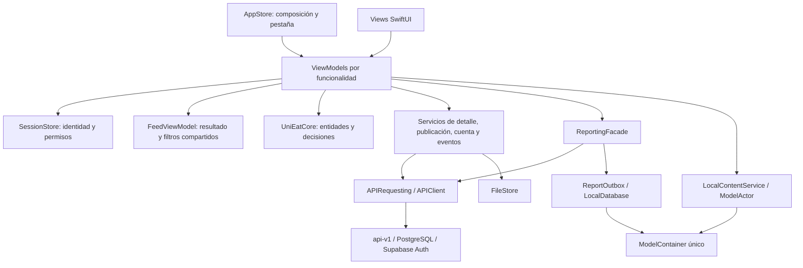

# Arquitectura actual de UniEat iOS

Esta estructura parte de los PR #40 y #41 de Juan Esteban: conserva sus modelos SwiftData,
archivos de detalle y borrador, lecturas en segundo plano y operaciones concurrentes.
La preparación distribuye esas responsabilidades por funcionalidad y corrige sus límites
de sesión y sincronización. El backend sigue siendo la autoridad de permisos, versiones y ranking.

## Componentes y comunicación

**Razón:** cada ViewModel concentra el estado y las acciones de su pantalla; los servicios
coordinan operaciones de datos. Las entidades se comparten entre pantallas. La sesión,
el feed aplicado, la cola y el contenedor tienen un único propietario para impedir estados divergentes.

| Pantalla o flujo | Estado y acciones | Dependencias principales |
|---|---|---|
| Acceso / registro | `AuthViewModel` | `SessionStore` |
| Hoy / copia del feed | `FeedViewModel` | API, reloj, conectividad, eventos |
| Filtros | `FiltersViewModel` | Feed compartido; el servicio de ubicación sigue leyendo GPS |
| Elige por mí | `RecommendationViewModel` | Mismo feed y filtros; conserva el orden del servidor |
| Detalle | `MenuDetailViewModel`, creado por publicación | `MenuDetailService`, guardados, eventos, reloj |
| Reporte / observación de fila | `ReportViewModel`, creado por formulario | `ReportingFacade` |
| Publicar / editar / cerrar | `PublishViewModel` | `PublishingService`, sesión, feed y reloj |
| Rendimiento / mis métricas | `PerformanceViewModel` | API, sesión, eventos |
| Perfil | `ProfileViewModel` | Sesión, guardados y estado de la cola |
| Solicitud de establecimiento | `EstablishmentViewModel` | `AccountService`, sesión y geocodificación |
| Aprobaciones / roles | `AdminApprovalsViewModel`, `AdminRolesViewModel` | `AccountService` y sesión |
| Guardados | `SavedMenusViewModel` | `LocalContentService`, SwiftData y eventos; migración del formato anterior |
| Piloto BQ-08 | `WaitIndicatorPilot` | Sesión, API de asignación y metadata de eventos |

`AppStore` es el punto de composición e inyección y conserva la pestaña seleccionada.
No es el ViewModel de todas las pantallas. `UniEatApp` inyecta los objetos compartidos;
los formularios de reporte y el detalle crean instancias de presentación propias mediante fábricas.
Una tarjeta o una etiqueta que solo renderiza información no necesita ViewModel propio.

## Modelos

`Packages/UniEatCore/Sources/UniEatCore/` contiene un archivo por entidad:
`DailyMenu`, `MenuDish`, `FeedFilters`, `Profile`, `ReportKind`, `PerformanceSummary`,
`PerformanceRates` y `UniEatDates`, además de las decisiones de vigencia y ubicación.
Se conserva el API público y el formato Codable que consumen las pantallas y las pruebas existentes.
`MenuDetail` representa la respuesta de vigencia/versiones/reportes y sirve a todo el flujo de detalle.

Los DTO del transporte permanecen en `Data/APIClient.swift`. `PublishDraft` y `DishDraft`
están junto a su ViewModel, porque representan el formulario. `MenuSnapshot` y `PendingReport`
permanecen en `Data/LocalDatabase.swift` como modelos de persistencia de Juan. La base local es
relacional y usa el mismo `ModelContainer`; la separación de entidades del dominio no crea nuevas bases.

Sprint 3 añade `SavedMenu`, `SavedDish` y `FeedCacheRecord` en `LocalContentModels.swift`.
`LocalContentService` crea `LocalContentStore` fuera de MainActor, con contexto propio sobre ese contenedor.
`SavedMenuEntry` es el valor Codable/Sendable de presentación y migración; los objetos SwiftData no cruzan
actores. `FeedMemoryCache` y `FeedImageStore` tienen políticas explícitas descritas en [sprint3.md](sprint3.md).

## Patrones y responsabilidades

- **MVVM, arquitectónico:** las vistas dibujan y envían acciones. Los ViewModels exponen estado
  observable y acciones de presentación. `UniEatCore` y los servicios contienen decisiones/datos.
- **Facade, diseño:** `ReportingFacade` ofrece `submitReport` y `flushReports`, coordinando sesión,
  almacenamiento, API y confirmación sin exponer ese protocolo a los formularios. Su ámbito son reportes.
- **Observer, diseño:** `ObservableObject`, `@Published` y las suscripciones de `FeatureViewModel`
  propagan cambios de las fuentes compartidas sin duplicar sus datos.
- **Transporte tipado e inyección:** `APIRequesting`, `SessionAuthenticating` y `ReportOutbox`
  permiten probar comportamiento sin red real. La inyección es una técnica de composición;
  no se contabiliza como un patrón GoF adicional.
- **Strategy en backend:** `rank-v1` sigue calculándose en el servidor. La recomendación conserva
  ese resultado; no se restaura la estrategia de la demo eliminada.

Juan conserva la autoría de la base de almacenamiento y de las estrategias de concurrencia.
La preparación de Kevin reorganiza esas implementaciones y añade límites, políticas de reintento,
pruebas y documentación. La funcionalidad pendiente de cada integrante sigue en sus issues originales.

## Concurrencia preservada y límites

- `SessionStore.refreshAccount` usa `async let` para pedir cuenta y establecimientos en paralelo.
  Comprueba usuario y generación de sesión antes de aplicar los dos resultados.
- `MenuDetailService.cached` lee y decodifica archivos con `Task.detached(priority: .utility)`.
  Devuelve valores `Sendable`; el reloj y la presentación se actualizan en `MainActor`.
- `MenuDetailViewModel.load` inicia copia y red con `async let`. La copia puede mostrarse mientras
  llega la respuesta. Las tareas pertenecen al `task` de la vista; la cancelación no se presenta como desconexión.
- `PublishingService.loadDraft` conserva la lectura `detached` de Juan; el ViewModel comprueba
  que el formulario no se haya editado mientras se leía, antes de restaurarlo.
- `ReportingFacade.flushReports` toma snapshots de valor y usa `withTaskGroup` con prioridad
  utility y hasta cuatro solicitudes simultáneas. Los objetos SwiftData y sus eliminaciones permanecen
  en `MainActor`. Un error temporal detiene la incorporación de más solicitudes al grupo.

La concurrencia no equivale a hacer trabajo pesado en la UI: las esperas de red suspenden tareas;
el trabajo de lectura/decodificación de archivos se ejecuta fuera del actor principal.
El tamaño máximo del grupo limita presión de red y cuotas sin perder las filas que faltan por enviar.

## Sesión, vigencia y sincronización

Cada petición captura una generación de autenticación; si cambia durante la obtención del token
o la respuesta, su resultado se cancela. Al cerrar sesión se cancela la renovación pendiente para
impedir que escriba otra vez en Keychain. Las respuestas de feed comprueban también identificador
de solicitud, usuario y filtros: una solicitud vieja con filtros idénticos tampoco pisa la última.

`ServerClock` toma la hora del servidor y avanza con `systemUptime`, independiente de cambios manuales
en el reloj del teléfono durante el proceso. Las copias guardan referencia de recepción para estimar
el tiempo al abrir de nuevo. Tras un reinicio sin red, esa estimación depende del tiempo local transcurrido;
la UI identifica los datos como copia y vuelve a sincronizar cuando hay respuesta del servidor.

Los reportes se guardan antes de enviarse. Su UUID es estable y se envía como `clientReportId`;
`observedAt` conserva la observación original. Solo una respuesta aceptada permite borrar la fila.
Los errores de red, 429, 5xx o de sesión conservan el reporte. Los rechazos definitivos conservan
la fila, muestran un aviso en Perfil y esperan un reintento explícito. Cambiar de cuenta limpia
la presentación; los pendientes y borradores permanecen separados por usuario para que su dueño
pueda retomarlos al volver a entrar.

Una base que no abre se conserva: no se elimina el archivo ni se informa falsamente que un reporte
quedó guardado. Este caso se muestra en Perfil y el formulario informa el fallo de persistencia.
